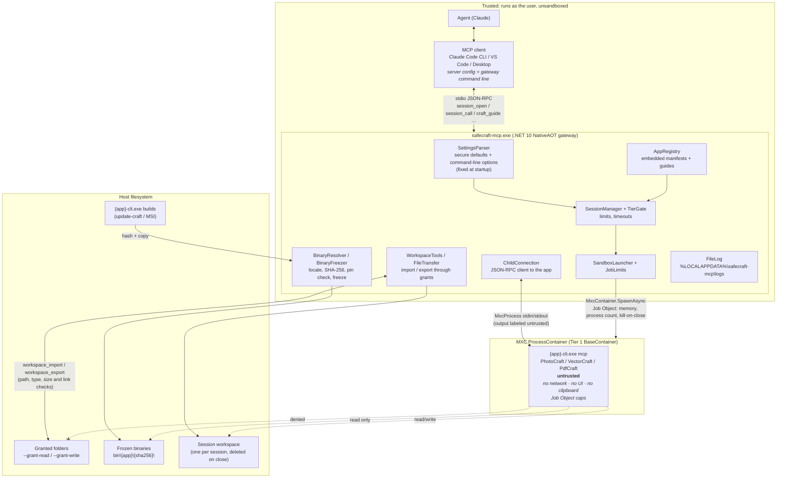

# safecraft-mcp

**Let an AI agent use creative apps without trusting them.** safecraft-mcp is an MCP server for
Windows that lets an agent (Claude Code, Claude Desktop, any MCP client) drive the open-source
PhotoCraft, VectorCraft and PdfCraft apps headless, while treating every app binary as untrusted.
Each app's command-line server runs inside a Windows MXC sandbox (Microsoft eXecution Container)
with no network, no UI and no access to your files. Files move in and out only through folders you
grant, one checked file at a time.

Each app runs in sandboxed sessions: open one (optionally with a file to open), call the app's own
tools (previews come back as images), move files in and out through the folders you grant, close
it. An escape suite checks the sandbox from inside. A curated guide, the live command catalog and a
starter prompt per app tell the agent how to drive it.

**Status:** early. PhotoCraft, VectorCraft and PdfCraft work; FilmCraft has a manifest but isn't
enabled until it has had its own sandbox check. The threat model is in [SECURITY.md](SECURITY.md).

## Architecture



- **Trust boundary:** only the app runs inside MXC. The agent, the client and the gateway are
  trusted.
- **Files never go directly between your folders and the app.** The gateway copies single files
  between the `--grant-*` folders and the session workspace; the app can't reach the grants.
- **Settings come only from the command line,** which is fixed in the client's MCP server config.
  No tool or tool argument can change them.
- **One container per session.** `craft_commands` also starts a short-lived container to fetch an
  app's command catalog, cached per binary hash.

More detail: [docs/architecture.md](docs/architecture.md), and what each app needs inside the
sandbox in [docs/sandbox-notes.md](docs/sandbox-notes.md).

## Requirements

- Windows 11 with MXC Process Isolation: 24H2/25H2 build x.9278 or later, 26H2 build 26300.9550
  or later (KB5124010), 26H1 build 28000.2804 or later. `doctor` says whether the host qualifies.
- The apps' CLIs, built by [update-craft](https://github.com/MGrunwald42/update-craft) after its
  safety check (`update-craft update photocraft` builds `photocraft-cli.exe` with the app), or installed
  under `C:\Program Files\<App>\`.
- To build: the .NET 10 SDK and, for the NativeAOT publish, the Visual Studio C++ build tools.

## Build and install

```powershell
.\publish.ps1                                   # → %LOCALAPPDATA%\Programs\safecraft-mcp
.\publish.ps1 -Destination C:\Tools\safecraft-mcp
dotnet test SafeCraftMcp.slnx                    # unit tests and the Mxc integration tests
dotnet test SafeCraftMcp.slnx --filter "Category!=Mxc"   # unit tests only
```

The integration tests (`tests/SafeCraftMcp.IntegrationTests`, `Category=Mxc`) run real sessions
of each app and the escape suite, one test class at a time; they skip themselves on a host without
MXC Process Isolation, and an app's tests skip without its built CLI. The escape suite builds `tests/HostileWorkload` (Rust, std
only) with `cargo`; its `mcp <behavior>` mode is a fake app that misbehaves (silent at the handshake,
floods, crashes, ignores stdin EOF, bad `command_list` answers) for the ChildConnection and
`craft_commands` tests.

`publish.ps1` installs `safecraft-mcp.exe` with MXC's native files next to it and prints its SHA-256;
`publish.ps1 -Release` instead packs `artifacts\release\safecraft-mcp-<version>-win-x64.zip` with a
`SHA256SUMS.txt`. The gateway logs to `%LOCALAPPDATA%\safecraft-mcp\logs\` (JSON lines, one file
per gateway process, kept two weeks). Sessions run a frozen copy of each CLI from
`%LOCALAPPDATA%\safecraft-mcp\bin\<app>\<sha256>\`; a copy no session used for two weeks is
deleted at the next start, except each app's newest.
Close the clients that run the gateway first; Windows doesn't let a running exe be replaced.

## Registering with the Claude clients

Two registrations, same exe and options:

- **Claude Code** (CLI, VS Code extension, the desktop app's Code tab share `~/.claude.json`):

  ```powershell
  claude mcp add --scope user safecraft -- "$env:LOCALAPPDATA\Programs\safecraft-mcp\safecraft-mcp.exe" --apps photocraft
  ```

- **Claude Desktop** (chat): `%APPDATA%\Claude\claude_desktop_config.json`

  ```json
  { "mcpServers": { "safecraft": {
      "command": "C:\\Users\\<you>\\AppData\\Local\\Programs\\safecraft-mcp\\safecraft-mcp.exe",
      "args": ["--apps", "photocraft"] } } }
  ```

`doctor` lists every registration it finds and whether their options agree.

## Options

Security settings are command-line options in the MCP server config, read once at startup. Every
default is the most secure value; an option can only relax it. Unknown options, malformed values
and values beyond the hard caps stop the gateway with an error. No environment variable, config
file, response file (`@file`) or MCP tool changes a setting. Paths must be absolute local paths;
they're resolved to their real location (junctions included) before they're checked.
`--help` (`-h`, `-?`) and `--version` print and exit.

| Option | Default | Effect |
|---|---|---|
| `--min-tier processisolation\|appcontainer` | `processisolation` | `appcontainer` also allows MXC's weaker AppContainer tiers (needs `wxc-host-prep`) |
| `--apps <app,app,…>` | every app with a found binary | which apps can be opened |
| `--repos <dir>` | `%USERPROFILE%\Documents\GitHub` | where to look for `<app>\target\release\<app>-cli.exe` |
| `--pin <app>=<sha256>` (repeatable) | none | only that exact build of the app runs |
| `--grant-read <name>=<dir>` (repeatable) | none | a folder files may be imported from; names are lowercase letters, digits, `-` and `_`, starting with a letter, at most 32, unique across both grant options |
| `--grant-write <name>=<dir>` (repeatable) | none | a folder files may be exported to; use a dedicated folder |
| `--import-ext <app>=<ext,…>` (repeatable) | the app's typical formats | replaces the app's import types |
| `--export-ext <app>=<ext,…>` (repeatable) | the app's typical formats | replaces the app's export types |
| `--max-file-mb <app>=<n>` (repeatable) | per app: PhotoCraft 2048, VectorCraft 512, PdfCraft 512, FilmCraft 16384 | per-file size cap, at most 65536 |
| `--mount-grants` | off | mounts read grants read-only and write grants read-write into the sandbox |
| `--keep-workspace` | off | keeps session workspaces after a session closes (marked `.kept`, so no gateway deletes them; delete them by hand) |
| `--upstream-docs` | off | serves the apps' raw upstream docs as resources |
| `--max-sessions <n>` | 2 | concurrent sessions, at most 8 |
| `--call-timeout <s>` | the app's (PhotoCraft 60) | seconds per tool call, at most 1800 |
| `--export-timeout <s>` | 300 | seconds per export or render call, at most 7200 |
| `--idle-timeout <s>` | 600 | seconds an unused session stays open, at most 86400 |
| `--max-lifetime <s>` | 3600 | seconds a session may live, at most 86400 |
| `--max-response-mb <n>` | 8 | largest tool response, at most 64 |
| `--max-preview-side <px>` | 1024 | largest preview side, 64 to 2048 |
| `--max-memory-mb <n>` | 8192 | memory a session's process tree may commit, 256 to 131072 |
| `--max-processes <n>` | 16 | processes a session may run at once, at most 256 |

Network (denied, host loopback included) and UI (disabled) have no option. Executables, scripts,
shortcuts, installers, keys and certificates are never importable or exportable, whatever the
extension options say. A grant can't be, contain or sit inside a protected folder (`.ssh`,
`.claude`, the client configs, the repos folder, the gateway's own state, browser profiles; the
full list is `HostPaths.Protected`).

## Tools

| Tool | What it does |
|---|---|
| `doctor` | MXC support and the tier a session would get, whether the tier gate allows it, the binaries found with their SHA-256, the client registrations and whether their options agree |
| `settings_show` | the effective settings, each with its source (default or option), including each app's import and export types and size cap, and the never-allowed types; read-only |
| `crafts_list` | the known apps: found or not, version, repo commit, SHA-256, pin, and whether a session can be opened (and if not, why) |
| `craft_guide {app}` | the curated guide to driving the app through the gateway (`guides/<app>.md`, embedded) |
| `craft_commands {app, filter?, enabled_only?}` | the app's command catalog, fetched once per build in a throwaway session and cached (labeled as app output) |
| `session_open {app, project?}` | starts the app's headless MCP server in a new sandbox; returns the session id, the isolation tier, the binary's SHA-256 and the app's tool names. `project` (`<read grant>/<path>`) imports that file and opens it |
| `session_tools {session}` | the app's own tools with schemas and hints |
| `session_call {session, tool, arguments?}` | calls one of the app's tools; images and progress pass through, previews are capped at `--max-preview-side`, export tools get `--export-timeout` |
| `session_read {session, uri}` | reads one of the app's resources (`photocraft://document`, `photocraft://commands`) |
| `session_close {session}` | stops the sandbox and deletes the workspace (unless `--keep-workspace`) |
| `grants_list` | the granted folders with their access (none by default) |
| `workspace_list {session}` | the files in a session's workspace (made by the app: labeled), links not followed |
| `workspace_import {session, grant, path, name?}` | copies a file from a read grant into the workspace |
| `workspace_export {session, path, grant, name?}` | copies a file from the workspace into a write grant |

Every tool has a title and all four annotation hints; unknown or mistyped arguments get JSON-RPC
`-32602`. Everything a session returns starts with a text block labeling it as untrusted app
output; app text in errors comes after the same label, and progress is forwarded as numbers only.
A call that times out is cancelled; if the app then doesn't answer a ping, its session is
closed. Idle sessions close after `--idle-timeout`, every session after `--max-lifetime`, and all
of them when the client disconnects.

Files move only as single files, done by the gateway: relative paths only (no `..`, drives,
streams or device names), only the app's import or export types (never executables, scripts,
shortcuts, keys or certificates), within the app's size cap and twice that per workspace, never
overwriting. Every check is made on the opened file, so a link or hard link the app leaves in its
workspace can't make an export read anything outside it.

The gateway also offers one prompt per app with a guide (`photocraft-start`, `vectorcraft-start`,
`pdfcraft-start`), each with an optional `task`. With `--upstream-docs` it serves the apps' own `docs/*.md` from their repos as resources
(`safecraft://<app>/docs/<name>.md`), labeled as untrusted repo text.

## License

Licensed under either of [MIT](LICENSE-MIT) or [Apache-2.0](LICENSE-APACHE), at your option.
Unless you say otherwise, any contribution you submit is licensed the same way, without
additional terms.

The app guides in `guides/` are based on the apps' own documentation; see [NOTICE](NOTICE).

safecraft-mcp is an independent project. It is not affiliated with, endorsed by or sponsored by
the ArtCraft Team, the makers of PhotoCraft, VectorCraft, PdfCraft and FilmCraft, or by Microsoft.
Those names are used only to say which software this works with.
