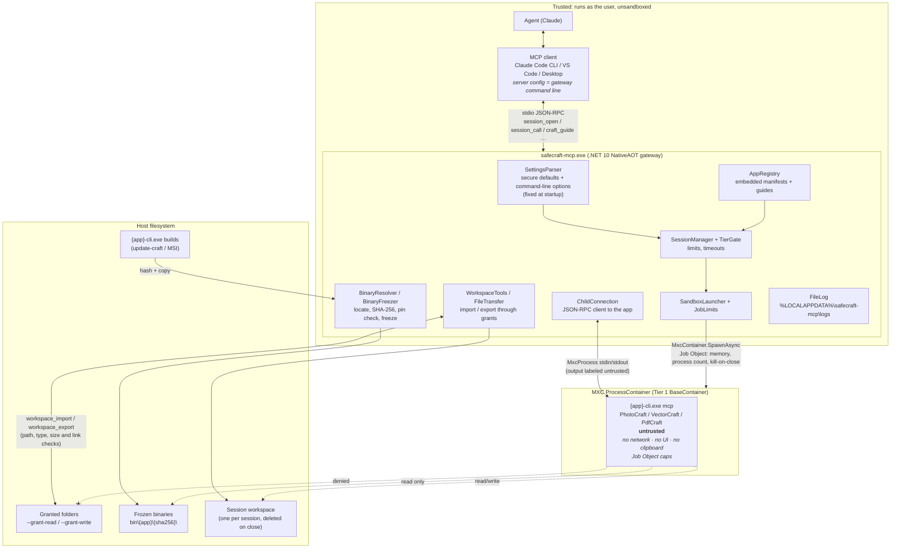

# Architecture

How the processes fit together. The threat model is in [SECURITY.md](../SECURITY.md), the
measurements behind each app's sandbox in [sandbox-notes.md](sandbox-notes.md).

- **Trust boundary:** only the app runs inside MXC. The agent, the client and the gateway are
  trusted.
- **Files never go directly between your folders and the app.** The gateway copies single files
  between the `--grant-*` folders and the session workspace; the app can't reach the grants.
- **Settings come only from the command line,** which is fixed in the client's MCP server config.
  No tool or tool argument can change them.
- **One container per session.** `craft_commands` also starts a short-lived container to fetch an
  app's command catalog, cached per binary hash.
